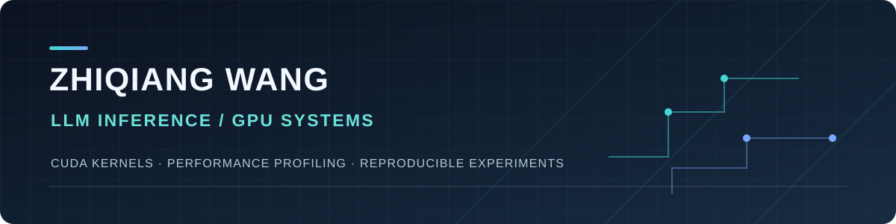

  

  <strong>GPU 编程 · LLM 推理系统 · 可复现实验</strong>

我正在学习 GPU 编程与大模型推理系统，重点关注 CUDA kernel 的实现、正确性验证和性能分析。这里展示有代码、测量方法和结果记录的项目。

## 代表项目

| [LLM 推理系统练习](https://github.com/Thymos2027/llm-inference-lab) | [期刊个人归档工具](https://github.com/Thymos2027/periodical-archiver) |
| :--- | :--- |
| 从 naive 到 shared memory、register tiling，逐步实现 FP32 CUDA 矩阵乘法；用 CUDA Event、Nsight 和 SASS 分析性能。 | 使用 Playwright 采集已获授权阅读的期刊内容，生成 EPUB、PDF、TXT、封面和摘要；支持失败记录与断点续抓。 |
| `CUDA` `C++` `GPU Profiling` | `JavaScript` `Playwright` `自动化` |

### 一组可检查的实验结果

在 RTX 5060 Ti 上，`1024³` 矩阵乘法的 register tiling kernel 中位时间为 **0.402 ms**，相对同程序 tiled 基线 **2.68×**。在 `M=1` 的形状上，同一版本反而更慢。[查看测量条件、正确性检查与完整数据 →](https://github.com/Thymos2027/llm-inference-lab/blob/main/01-cuda-matmul/BENCHMARKS.md)

> 以上是 FP32 矩阵乘法 kernel 的计时结果，不代表完整模型的推理吞吐。
